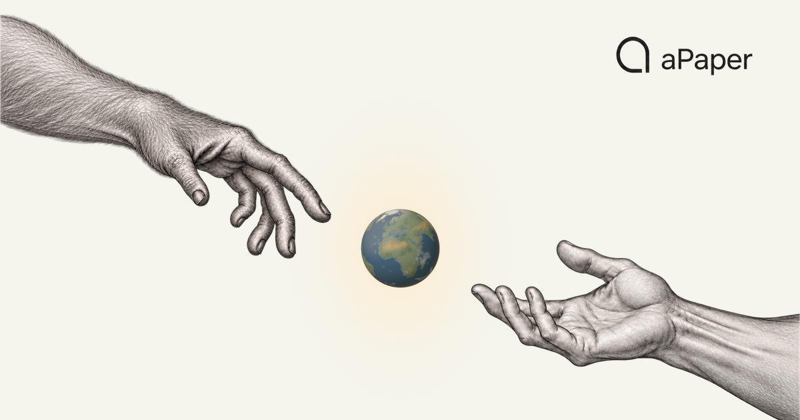

  
  <h1>Less time. More insight.</h1>
  
Discover papers. Understand ideas. Connect knowledge. Create new research on what you already understand.

  
<strong>An AI-native research workspace, built for Mac.</strong>

  
<a href="https://apaper.ai">Website</a> &nbsp; / &nbsp; <a href="#product">Explore</a> &nbsp; / &nbsp; <a href="#download">Download</a> &nbsp; / &nbsp; <a href="RELEASES.md">Release notes</a> &nbsp; / &nbsp; <a href="https://github.com/YociLam/aPaper/issues">Feedback</a>

  
<strong>English</strong> · <a href="README.zh-CN.md">简体中文</a>

  
macOS 14.6+ &nbsp; · &nbsp; Apple silicon &nbsp; · &nbsp; First release 0.1.0 in preparation

---

## From literature to manuscript.

Research is more than collecting papers. aPaper connects discovery, close reading, research knowledge, and writing so your questions, evidence, and judgement can carry forward in one workspace.

<table>
  <tr>
    <td width="25%" align="center">01 <strong>Discover</strong></td>
    <td width="25%" align="center">02 <strong>Understand</strong></td>
    <td width="25%" align="center">03 <strong>Connect</strong></td>
    <td width="25%" align="center">04 <strong>Create</strong></td>
  </tr>
</table>

<table>
  <tr>
    <td width="50%" valign="top">
      
      
01 &nbsp; / &nbsp; DISCOVER

      <h3>Daily Research</h3>
      
<strong>Start each day with what is worth reading.</strong>

      
Follow academic sources in your field and find new papers gathered in one place.

      
<a href="https://apaper.ai#chapter-daily">Explore on the website ↗</a>

    </td>
    <td width="50%" valign="top">
      
      
02 &nbsp; / &nbsp; DISCOVER

      <h3>Library</h3>
      
<strong>Every paper in its place.</strong>

      
Keep papers, metadata, and projects together. Bring a Zotero library across, or import a paper or a folder.

      
<a href="https://apaper.ai#chapter-library">Explore on the website ↗</a>

    </td>
  </tr>
  <tr>
    <td width="50%" valign="top">
      
      
03 &nbsp; / &nbsp; UNDERSTAND

      <h3>Insight</h3>
      
<strong>See the structure before the detail.</strong>

      
Grasp the research question, method, contribution, and limitations before the close reading.

      
<a href="https://apaper.ai#chapter-insight">Explore on the website ↗</a>

    </td>
    <td width="50%" valign="top">
      
      
04 &nbsp; / &nbsp; UNDERSTAND

      <h3>Mentor</h3>
      
<strong>Every answer has a source.</strong>

      
Ask about the paper in front of you. Follow source-linked answers back to the original passages.

      
<a href="https://apaper.ai#chapter-mentor">Explore on the website ↗</a>

    </td>
  </tr>
  <tr>
    <td width="50%" valign="top">
      
      
05 &nbsp; / &nbsp; CONNECT

      <h3>Recall</h3>
      
<strong>What you read stays within reach.</strong>

      
Keep concepts, findings, and questions tied to their evidence. Review AI candidates before they become knowledge.

      
<a href="https://apaper.ai#chapter-recall">Explore on the website ↗</a>

    </td>
    <td width="50%" valign="top">
      
      
06 &nbsp; / &nbsp; CREATE

      <h3>Research Workbench</h3>
      
<strong>Write what you understand.</strong>

      
Organize manuscript projects, write and preview LaTeX, and revise with a research assistant alongside you.

      
<a href="https://apaper.ai#chapter-workbench">Explore on the website ↗</a>

    </td>
  </tr>
</table>

## Make room for your next study.

> **aPaper 0.1.0 is in preparation.** No public installer or release date is available yet.

The first release is for **Apple silicon Macs · macOS 14.6 or later**. Intel Mac, Windows, and Linux packages are not currently available.

[Release status →](RELEASES.md) &nbsp; · &nbsp; [Installation guide](INSTALL.md)

<strong>How will I download and install it?</strong>

Download the versioned `aPaper.dmg` asset from this repository's Releases when published. The actual package will include its size, SHA-256, signing and notarization status, and supported update behavior. GitHub's automatic Source code archives are repository snapshots.

## Start with the way you work.

<strong>Model services and AI features</strong>

Your library and reading work without a model. Insight, Mentor, and other AI features use the model service you configure in Settings; its provider sets the pricing and data rules. Official paid model service is not currently available. AI can be wrong: check important conclusions and citations against original sources.

<strong>Your local library and data</strong>

Papers, notes, and research memory are managed in a local library on your computer. Online and AI features send the query and relevant content to the services they use. Keep backups of important work.

<strong>Zotero import and languages</strong>

Zotero import makes a one-time, read-only copy. It does not modify the original library or enable ongoing synchronization. The App supports English, Simplified Chinese, Traditional Chinese, Japanese, and Korean.

## Help shape a better research workspace.

Found a problem or have an idea? [Open an issue](https://github.com/YociLam/aPaper/issues) with your aPaper version, macOS version, and reproduction steps. For account questions or private support, email [contact@apaper.ai](mailto:contact@apaper.ai). Security reports: [SECURITY.md](SECURITY.md).

<strong>About this repository and its artwork</strong>

This is aPaper's public home for product information, downloads, release notes, and feedback. The App source is private. [aPaper-Cloud](https://github.com/YociLam/aPaper-Cloud) maintains update archives and public research metadata.

The hero artwork comes directly from the aPaper website. Icons use the website's Phosphor glyphs; see [assets/icons/LICENSE](assets/icons/LICENSE). Third-party notices and required runtime material accompany the distributed App; this repository grants no license to private application source. Remove keys, account details, and private research material before sharing screenshots or logs.

---

  
<strong>Begin with the paper on your desk.</strong>

  
<a href="https://apaper.ai">Discover · Understand · Connect · Create ↗</a>

