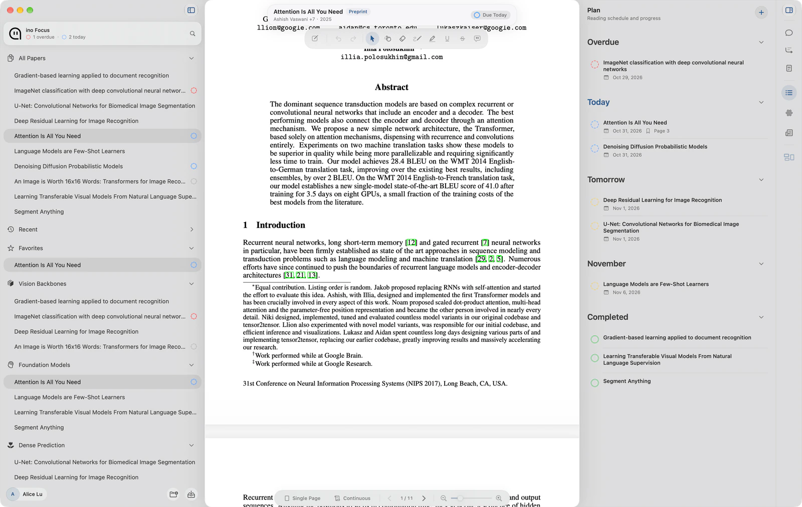
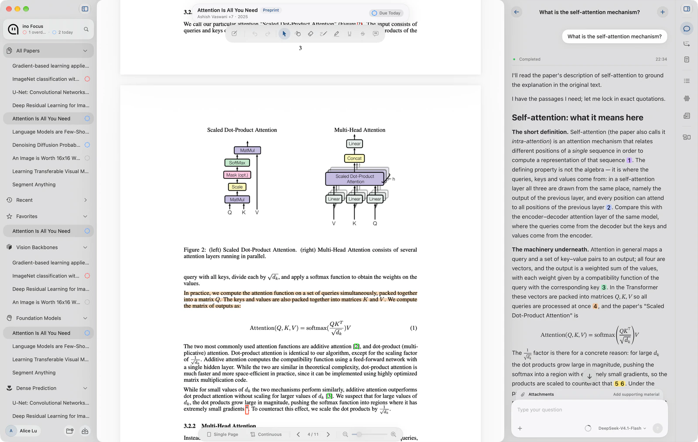
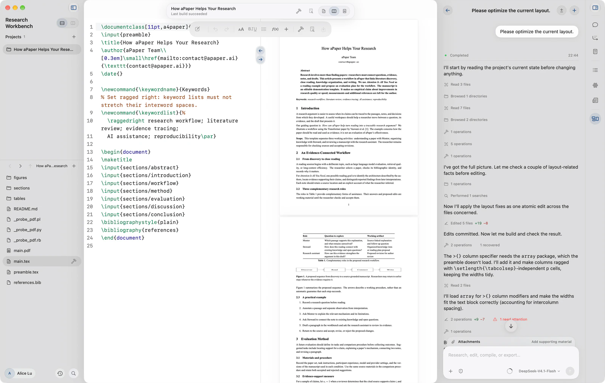

  
  <h1>aPaper</h1>
  
<strong>Less time. More insight.</strong>

  
A native Mac workspace for discovering papers, understanding ideas, connecting knowledge, and writing your next study.

  
<a href="https://apaper.ai">Website</a> · <a href="#download">Download</a> · <a href="RELEASES.md">Release notes</a> · <a href="https://github.com/YociLam/aPaper/issues">Feedback</a>

  
<strong>English</strong> · <a href="README.zh-CN.md">简体中文</a>

Research rarely happens in one step. A paper leads to a question, a passage becomes a note, and an idea returns when you begin to write. aPaper brings those steps into one workspace, keeping your papers, their evidence, and your own work within reach.

## From literature to manuscript

| | What you can do |
| --- | --- |
| **Daily Research** | Follow academic sources and find new papers in your field. |
| **Library** | Organize papers, metadata, and projects. Import individual PDFs, folders, or a one-time copy of your Zotero library. |
| **Insight** | Get an overview of a paper's question, method, contributions, and limitations before reading closely. |
| **Mentor** | Ask questions as you read, with source-linked answers you can check against the paper. |
| **Knowledge** | Connect findings, concepts, and research questions with their supporting evidence, then return to them in later work. |
| **Research Workbench** | Write in a project workspace, build and preview LaTeX manuscripts, and work with a research assistant. |

### Read with the evidence beside you

Move between a question, its explanation, and the original passage without losing your place in the paper.

### Build on what you understand

Bring your notes and research questions into a manuscript. Keep project files, the editor, PDF preview, and assistant together as you revise.

*Screenshots use a demonstration workspace. AI responses are examples; check conclusions and citations against the original sources.*

## Download

**The first public release, aPaper 0.1.0, is in preparation. No installer is available from this repository yet.**

| Platform | Requirements | Availability |
| --- | --- | --- |
| macOS | Apple silicon · macOS 14.6 or later | 0.1.0 in preparation |
| Intel Mac, Windows, Linux | — | No package available |

Once published, the versioned **`aPaper.dmg`** asset will appear in [Releases](https://github.com/YociLam/aPaper/releases). The [installation guide](INSTALL.md) explains how to install and verify it. Signing, notarization, checksums, and update support will be stated for the actual package.

## Before you begin

- **Bring your model service.** AI features use the model service you configure in Settings. The provider's pricing and data policies apply. Official paid model service is not currently available.
- **Keep your research under your care.** Papers, notes, and research memory are managed in a local library. Online and AI features send the query and relevant content to the services they use. Keep backups of important work.
- **Start with your existing library.** Zotero import is a one-time, read-only copy; it does not enable ongoing synchronization or modify your Zotero library.
- **Choose your language.** The App supports English, Simplified Chinese, Traditional Chinese, Japanese, and Korean.

## Feedback and support

Found a problem or have an idea? [Open an issue](https://github.com/YociLam/aPaper/issues) with your aPaper version, macOS version, and steps to reproduce it. For account questions or private support, email [contact@apaper.ai](mailto:contact@apaper.ai). Report security issues using [SECURITY.md](SECURITY.md).

Please remove API keys, account details, and private research material from screenshots and logs before sharing them.

## About this repository

This is aPaper's public home for product information, downloads, release notes, and feedback. The application source is private. Update archives and public research metadata are maintained in [aPaper-Cloud](https://github.com/YociLam/aPaper-Cloud).

GitHub's automatic **Source code** ZIP/tar downloads contain this repository's public files; install the DMG release asset to use the App. Third-party notices and required runtime material accompany the distributed application. This repository does not grant a license to the private application source.
