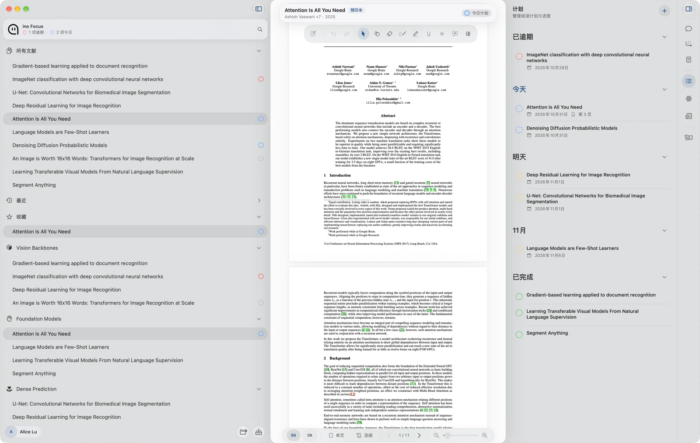
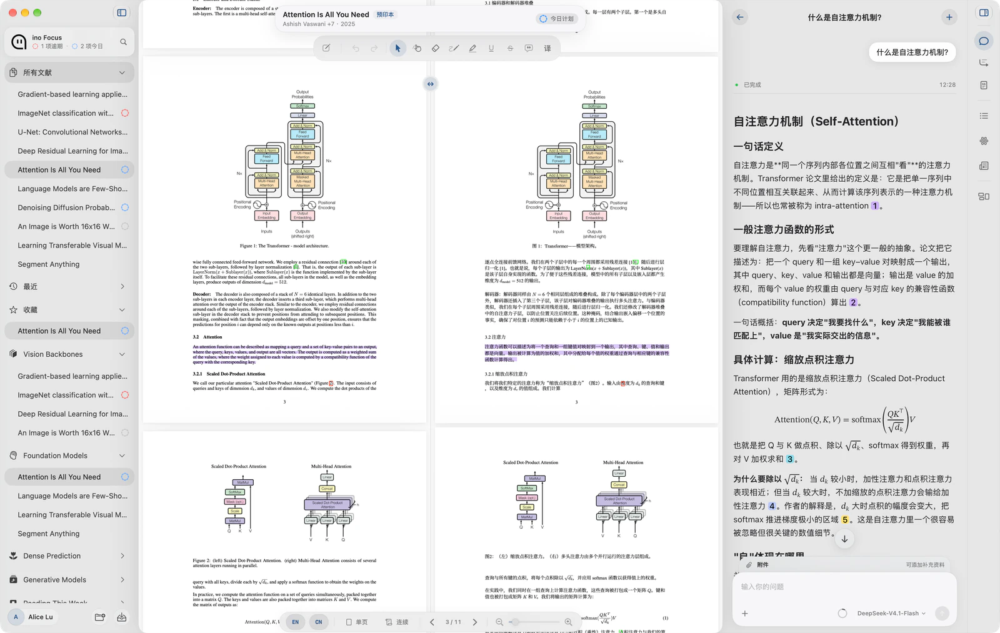
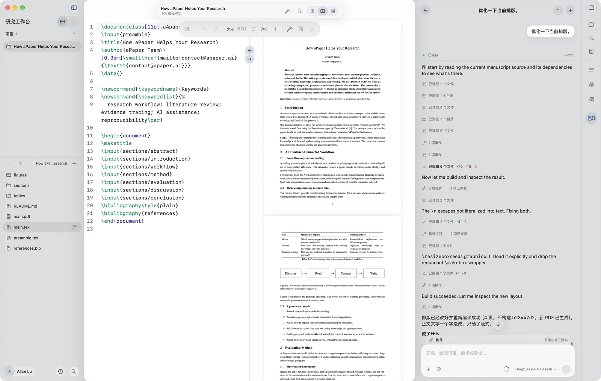

  
  <h1>aPaper</h1>
  
<strong>少一点耗时，多一点洞见。</strong>

  
为 Mac 打造的研究工作空间。 发现论文、理解思想、连接知识，写出你的下一项研究。

  
<a href="https://apaper.ai">官网</a> · <a href="#下载">下载</a> · <a href="RELEASES.md">版本记录</a> · <a href="https://github.com/YociLam/aPaper/issues">反馈建议</a>

  
<a href="README.md">English</a> · <strong>简体中文</strong>

研究很少一步完成。一篇论文引出一个问题，一段原文成为一条笔记，一个读过的想法在写作时重新出现。aPaper 把这些环节连接在同一个工作空间，让论文、原文证据和你自己的研究积累始终触手可及。

## 从文献到论文

| 模块 | 你可以做什么 |
| --- | --- |
| **每日研究** | 关注学术来源，发现研究领域中的新论文。 |
| **文献库** | 整理论文、元数据和项目；导入单篇 PDF、整个文件夹，或一次性导入 Zotero 文献库副本。 |
| **洞见 Insight** | 在精读前，先了解论文的研究问题、方法、贡献与局限。 |
| **导师 Mentor** | 边读边问，通过带有原文引用的回答，回到论文核查依据。 |
| **知识** | 将发现、概念和研究问题与支撑证据连接起来，在后续研究中再次调用。 |
| **研究工作台** | 按项目写作，编译和预览 LaTeX 稿件，与研究助手一起推进修改。 |

### 理解与证据，放在一起

在问题、解释和原文之间切换，让每一次追问都能回到正在阅读的论文。

### 把理解写成自己的研究

从积累的笔记和问题开始写作。项目文件、编辑器、PDF 预览与研究助手同处一屏，让修改与核查衔接起来。

*截图来自演示工作空间。AI 回答仅作示例，重要结论和引用仍需对照原文核查。*

## 下载

**首个公开版本 aPaper 0.1.0 正在准备中，本仓库暂未提供安装包。**

| 平台 | 系统要求 | 状态 |
| --- | --- | --- |
| macOS | Apple silicon · macOS 14.6 或更高版本 | 0.1.0 准备中 |
| Intel Mac、Windows、Linux | — | 暂无安装包 |

发布后，请从 [Releases](https://github.com/YociLam/aPaper/releases) 下载明确版本的 **`aPaper.dmg`**。安装和校验步骤见[安装说明](INSTALL.md)。签名、公证、校验值及更新能力以实际发布包的说明为准。

## 开始前了解这些

- **配置自己的模型服务。** AI 功能使用你在设置中配置的模型服务，其费用与数据规则由服务商规定。官方付费模型服务目前尚未开放。
- **妥善保存研究资料。** 论文、笔记和研究记忆在本地文献库中管理；使用在线或 AI 功能时，查询及相关内容会发送至对应服务。请自行备份重要资料。
- **接续已有文献库。** Zotero 导入是一次性、只读的副本导入，不修改原文献库，也不启用持续同步。
- **选择熟悉的语言。** 应用支持英文、简体中文、繁体中文、日文和韩文。

## 反馈与支持

发现问题或有改进建议，欢迎[提交 Issue](https://github.com/YociLam/aPaper/issues)，附上 aPaper 版本、macOS 版本及复现步骤。账号问题或私密支持请联系 [contact@apaper.ai](mailto:contact@apaper.ai)。安全问题请按 [SECURITY.md](SECURITY.md) 中的方式报告。

分享截图或日志前，请移除 API 密钥、账号信息和私人研究资料。

## 关于本仓库

这里是 aPaper 的产品介绍、软件下载、版本记录与反馈入口。应用源码暂不公开。更新归档与公开研究元数据由 [aPaper-Cloud](https://github.com/YociLam/aPaper-Cloud) 维护。

GitHub 自动生成的 **Source code** ZIP/tar 只包含本仓库的公开文件；使用应用请下载安装包 DMG。第三方声明与必要运行时材料随应用分发。本仓库不授予私有应用源码许可。
